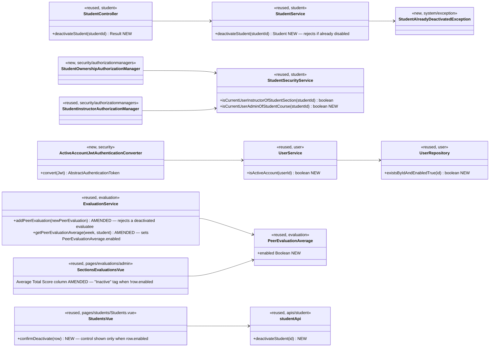

# Student (STU) Design

> Realizes: UC-STU-deactivate-student
> Depends on: BR-student-lifecycle, BR-evaluatee-active (new), BR-section-scoped-access, BR-role-based-access, FR-SEC-active-account, FR-SEC-authorization, FR-SEC-deny-unauthorized
> See: [use cases](../requirements/use-cases.md#student), [business rules](../requirements/business-rules.md), [SRS non-use-case FRs](../requirements/software-requirements-specification.md#security-and-authorization-requirements), [architectural-design.md](architectural-design.md#shared-foundation-components) (shared-foundation component view, Security & Compliance, Runtime View)
> Designed against `main` at `59f0267` (2026-11-06).

## Overview

This area gives `UC-STU-deactivate-student` a deliberate, confirmed, authorized path, in place of the undocumented `enabled`-flag side effect of `PUT /students/{studentId}`. Deactivating a student is a visible event to the rest of her team, so this design also closes the two places that event reaches: a new peer evaluation of her (`BR-evaluatee-active`, in `evaluation`) and the section's weekly peer-evaluation report (in `evaluation`). It additionally closes a gap in the platform-wide authentication path: `FR-SEC-active-account` promised denied *access*, not merely denied *login*, and until now enforcement lived only at login, leaving a logged-in student's JWT valid for up to its remaining 2h after deactivation.

`student` is one of the shared-foundation bounded contexts (`course` · `section` · `team` · `student` · `instructor`) in [architectural-design.md](architectural-design.md#shared-foundation-components); this is its first Level-2 design. The platform-wide authentication change (below) sits in `security`/`user`, which every area — including RAM — inherits.

`UC-STU-reactivate-student` is not designed here; it stays on the existing edit form's `Status` switch (`PUT /students/{studentId}`) until it gets its own `/design` run. `UC-INS-deactivate-instructor` (a different area) is untouched by this design but inherits the authentication-path fix for free, since it covers both students and instructors.

## Components & classes



File pointers (reused unless marked new): `backend/src/main/java/team/projectpulse/student/StudentController.java`, `StudentService.java`, `StudentSecurityService.java`; `system/exception/StudentAlreadyDeactivatedException.java` *(new)*, `system/exception/ExceptionHandlerAdvice.java`; `security/SecurityConfiguration.java`; `security/authorizationmanagers/StudentOwnershipAuthorizationManager.java` *(new)*; `security/ActiveAccountJwtAuthenticationConverter.java` *(new)*; `user/UserService.java`, `user/UserRepository.java`; `evaluation/EvaluationService.java`, `evaluation/PeerEvaluationAverage.java`; `frontend/src/pages/students/Students.vue`, `frontend/src/apis/student/index.ts` + `types.ts`; `frontend/src/pages/evaluations/admin/SectionsEvaluations.vue` and `StudentEvaluations.vue`.

## Sequence

### UC-STU-deactivate-student: main success scenario (steps 1–7)

```mermaid
sequenceDiagram
    actor Actor as Course admin / instructor
    participant V as Students.vue (reused)
    participant API as apis/student (reused)
    participant SEC as SecurityConfiguration<br/>anyOf(studentInstructor, studentOwnership)
    participant C as StudentController (reused)
    participant S as StudentService (reused)
    participant R as StudentRepository (reused)

    Actor->>V: 1. Chooses Deactivate on a student row<br/>(control shown only when row.enabled)
    V-->>Actor: 2-3. The row is the student's detail view (UC-STU-view-student);<br/>the control names the intent
    V-->>Actor: 4. ElMessageBox.confirm states the consequences: no login,<br/>no WAR or peer-evaluation submission, work and team kept, reversible
    Actor->>V: 5. Confirms (5a: cancels — nothing sent, use case ends)
    V->>API: deactivateStudent(studentId)
    API->>SEC: POST /students/{studentId}/deactivation
    SEC->>SEC: instructor assigned to her course section OR course admin<br/>who owns its course, and the student exists? (1a otherwise → 403)
    SEC->>C: authorized
    C->>S: deactivateStudent(studentId)
    S->>S: already enabled == false? (3a → reject, see below)
    S->>R: save (enabled = false)
    R-->>S: student
    S-->>C: student
    C-->>V: 200 Result(StudentDto)
    V-->>Actor: 6. Toast "<name> has been deactivated"; list reloads,<br/>Status → Disabled, Deactivate control now hidden for this row
    Note over Actor,R: 7. Use case ends. POST-1 holds: enabled = false; every WAR,<br/>peer evaluation, and her team and course-section link untouched (BR-student-lifecycle).
```

### UC-STU-deactivate-student: extensions 1a, 3a, 5a

```mermaid
sequenceDiagram
    participant V as Students.vue
    participant SEC as route guard
    participant S as StudentService

    rect rgb(245,245,245)
    Note over V,SEC: 1a — neither assigned instructor nor owning course admin,<br/>or no such student (OI-48: both fail the same way)
    V->>SEC: POST /students/{id}/deactivation
    SEC-->>V: 403 "No permission." — the guard resolves the student and fails closed
    end

    rect rgb(245,245,245)
    Note over V,S: 3a — already deactivated: a rejection, not a 200<br/>(the control is hidden, so this is the race / direct-call path)
    V->>S: POST on a student already disabled
    S-->>V: 409 CONFLICT, Result message "This student is already deactivated."
    end

    rect rgb(245,245,245)
    Note over V,SEC: 5a — the actor cancels the confirmation dialog
    V->>V: ElMessageBox rejected
    Note over V: No request sent; use case ends
    end
```

### The postcondition taking effect (FR-SEC-active-account)

```mermaid
sequenceDiagram
    actor Student as The deactivated student (already logged in)
    participant SPA
    participant JWTF as Bearer-token filter<br/>+ account-state converter (new)
    participant US as UserService (reused)
    participant DB

    Student->>SPA: Any action, with the JWT she already holds
    SPA->>JWTF: GET /api/v1/... (Bearer, signature still valid, not expired)
    JWTF->>JWTF: verify signature + expiry, read the signed userId claim
    JWTF->>US: isActiveAccount(userId)
    US->>DB: existsByIdAndEnabledTrue(userId)  (primary-key read)
    DB-->>US: false
    US-->>JWTF: false
    JWTF-->>SPA: DisabledException → existing AccountStatusException handler<br/>401 Result "User account is abnormal."
    SPA->>SPA: Axios interceptor clears the token + user stores, redirects to login
    SPA-->>Student: Login screen; a login attempt is refused too
```

### The ripple into peer evaluations (BR-evaluatee-active)

```mermaid
sequenceDiagram
    actor Teammate as A teammate (still active)
    participant SPA
    participant EC as EvaluationController (reused)
    participant ES as EvaluationService (reused, AMENDED)

    Teammate->>SPA: Submits a peer evaluation naming the deactivated student
    SPA->>EC: POST /evaluations
    EC->>ES: addPeerEvaluation(newPeerEvaluation)
    ES->>ES: existing checks (window, team, duplicate) pass
    ES->>ES: evaluatee.isEnabled() == false
    ES-->>EC: PeerEvaluationIllegalArgumentException<br/>"You cannot submit a peer evaluation of <name>; her account has been deactivated."
    EC-->>SPA: 400 INVALID_ARGUMENT, Result envelope
    Note over ES: An evaluation already submitted before her deactivation<br/>is untouched — this guards new submissions only (addPeerEvaluation,<br/>not updatePeerEvaluation, which the submission window already bounds)
```

### Account lifecycle (state)

```mermaid
stateDiagram-v2
    [*] --> Active: UC-ACC-setup-student-account<br/>(saveStudent sets enabled = true)
    Active --> Deactivated: UC-STU-deactivate-student<br/>POST /students/{id}/deactivation
    Deactivated --> Active: UC-STU-reactivate-student — NOT YET DESIGNED;<br/>interim path is the edit form's Status switch (PUT /students/{id})
    Active --> [*]: UC-STU-delete-student (physical, cascades WARs + evaluations)
    Deactivated --> [*]: UC-STU-delete-student
    note right of Deactivated
        Login refused, and every in-flight request refused
        on its next call (FR-SEC-active-account).
        Work, team, and course-section links retained (BR-student-lifecycle).
        Excluded from reminders (BR-submission-owed).
        No new peer evaluation of her may be submitted (BR-evaluatee-active).
        Appears in the section report every week, marked inactive, not 0.0.
    end note
```

## API contract

| Endpoint or job | Caller (who may) | Request | Success | Errors, by extension |
|---|---|---|---|---|
| `POST /api/v1/students/{studentId}/deactivation` *(new)* | An instructor assigned to the student's course section, or the course admin who owns its course (`BR-student-lifecycle`, `BR-section-scoped-access`, `BR-role-based-access`): `AuthorizationManagers.anyOf(studentInstructorAuthorizationManager, studentOwnershipAuthorizationManager)`, above `denyAll()`. Not the student herself. | No body. Deactivate-only. | `200` `Result(StudentDto)`, `enabled` false | **1a** neither assigned instructor nor owning course admin, the student herself, or no such student: `403` "No permission." **3a** already deactivated: `409 CONFLICT`, "This student is already deactivated." — not `200`; the UI does not offer the control for this row. |
| `POST /api/v1/evaluations` *(existing, amended)* | unchanged | unchanged | unchanged | New: the evaluatee's account is deactivated: `400 INVALID_ARGUMENT`, naming her and the condition (`BR-evaluatee-active`). |
| The section peer-evaluation report (`generateWeeklyPeerEvaluationReportForSection`, via `apis/evaluation`) *(amended)* | unchanged | unchanged | `200`: each `PeerEvaluationAverage` gains `enabled` (the student's current account state); a deactivated teammate still appears every week she is on the team (`BR-student-lifecycle`) | unchanged |
| Every bearer-authenticated API request *(cross-cutting)* | — | — | unchanged | A request whose `userId` names a deactivated or deleted account: `401` "User account is abnormal." A token with a missing or non-numeric `userId` claim: `401`. |
| `PUT /api/v1/students/{studentId}` *(existing)* | unchanged | unchanged | unchanged | Unchanged — keeps writing `enabled`, as the interim reactivation path. |

## Key decisions

1. **A dedicated action sub-resource, not the generic `PUT`.** The use case needs a distinct intent, a consequence warning, and a confirmation; a field inside an edit form carries none of those. *Rejected:* the edit form's `Status` switch as the designed path. Follows the repo's existing action sub-resource precedent, `POST /sections/{sectionId}/reminders`.
2. **Deactivate-only, no request body.** No field carries the opposite intent, so no reviewer or agent has to ask whether the route reactivates. *Rejected:* `PATCH /students/{studentId}/enabled` with `{enabled: false|true}` — ships undesigned reactivation behavior. The natural counterpart once `UC-STU-reactivate-student` is designed is `DELETE` of the same sub-resource.
3. **`updateStudent` keeps writing `enabled`; the edit form's Status switch stays**, because reactivation must stay reachable. Residual, accepted: two write paths to `enabled` coexist until the reactivate design lands, and the older one can still deactivate with no warning and no `3a` rejection (OI-33).
4. **Authorization is `anyOf(assigned instructor, owning course admin)`**, via a new `StudentOwnershipAuthorizationManager`. `userOwnershipAuthorizationManager` also admits the student herself (who must not deactivate herself); `studentInstructorAuthorizationManager` alone would shut out an owning-but-unassigned course admin. Mirrors the existing UC-NOT rule. *Rejected:* widening `StudentInstructorAuthorizationManager` in place — it also guards private peer-evaluation-comment reads. **Invariant the reused and new security-service methods must hold:** neither `isCurrentUserInstructorOfStudentSection` nor `isCurrentUserAdminOfStudentCourse` may filter on `enabled` — both resolve the student by id alone, as `isCurrentUserInstructorOfStudentSection` already does today. If either silently excluded a disabled student, extension `3a` could never be reached: the route would answer `403` before the service ever got a chance to answer `409`.
5. **Deactivation takes effect on the very next request, not merely at login** (closes the ≤2h token window). `UserService.isActiveAccount` is a primary-key read — no migration. A new `ActiveAccountJwtAuthenticationConverter` replaces the `jwtAuthenticationConverter()` bean's return, delegating to it first, then rejecting a non-active account with `DisabledException` (lands on the existing `AccountStatusException` handler → `401`) and a missing/non-numeric `userId` claim with `InvalidBearerTokenException`. **Wiring constraint:** inject `UserService` as a `@Bean`-method parameter, never into `SecurityConfiguration`'s constructor — `UserService` depends on the `passwordEncoder` bean declared in the same class, so constructor injection is a bean-creation cycle. Covers instructors too, for free. *Rejected:* a short-TTL cache (reopens the staleness window being fixed); a revocation blocklist (new infra, different question — a leaked token on a still-active account); refresh tokens (a whole new flow); a `OncePerRequestFilter` (ordering, re-derives a principal the converter already built); an `OAuth2TokenValidator` (would report a valid token as `invalid_token`).
6. **No reason field, no email, no schema change.** The use case, unlike `UC-INS-deactivate-instructor`'s "enter a reason" step, asks for neither.
7. **Already-deactivated is `409 CONFLICT`, not `200`.** Silently succeeding on a no-op hides that two actors observed different states. *Rejected:* `200` idempotent — this is an action verb, not a state assignment. *Rejected:* `400` via a `*IllegalArgumentException` (the pattern elsewhere) — that family guards malformed input; this request has none, and the problem is the resource's current state conflicting with the action, which `409` means (matching `SectionLockRequiredException`, which reuses the **same existing `StatusCode.CONFLICT` constant** — no new `StatusCode` entry). *Rejected:* `423 LOCKED` (`SectionAlreadyLockedException`'s status) — that family is WebDAV editing-lock semantics, the wrong fit despite the naming echo. `deactivateStudent` resolves the student with the same `findById().orElseThrow(ObjectNotFoundException)` shape every other `StudentService` method already uses; a student deleted in the narrow race between the authorization check and this call is a pre-existing characteristic of every guarded route in the codebase, not something this design introduces or needs to engineer around.
8. **Peer evaluation of a deactivated evaluatee is rejected going forward, not retroactively.** One check in `addPeerEvaluation`, reusing `PeerEvaluationIllegalArgumentException`. *Rejected:* also guarding `updatePeerEvaluation` — the submission window already bounds edits in the ordinary case, and guarding it too would additionally block a same-week edit filed *before* her deactivation, rewriting history rather than stopping new submissions.
9. **The section report marks a deactivated teammate inactive via a new `enabled` flag, not by nulling or hiding the score.** The report query already keeps anyone with a team (no `enabled` filter), so no change to who is listed. *Rejected:* setting `averageTotalScore` to `null` — three templates call `.toFixed(2)` on it unconditionally, so a nullable score is a template crash waiting to happen, for a distinction the use case does not ask the UI to draw. Applied to `SectionsEvaluations.vue` and, for consistency on the identical field, `StudentEvaluations.vue`. Not applied to `MyEvaluations.vue` — unreachable by a deactivated student (decision 5 above).

## Data model

No schema delta. `enabled` already exists on `peer_evaluation_user`, `NOT NULL`. The authentication-path lookup is by primary key. No Flyway migration, no `DataInitializer` change. See the SRS's Business Domain Model for the shared graph; nothing is redrawn here.

## Reuse & cross-cutting

Leans on: the `security` two-point enforcement model and `AuthorizationManagers.anyOf`; `StudentSecurityService`; the configured `JwtAuthenticationConverter` and `CustomBearerTokenAuthenticationEntryPoint`; the `AccountStatusException` handler already in `ExceptionHandlerAdvice`; the `Section*Exception` typed-exception-per-domain pattern; `Result`/`StatusCode`; `UserService`/`UserRepository`; the Axios instance's `401` handling; Element Plus `ElMessageBox.confirm`; `EvaluationService.addPeerEvaluation`'s existing `PeerEvaluationIllegalArgumentException` pattern; `SubmissionStatusService`'s `isEnabled()` filter (reminders already stop for a deactivated student, `BR-submission-owed`).

Genuinely new: one route rule; one `AuthorizationManager`; one security-service method; one controller method; one service method; one typed exception + handler; one JWT converter; two one-line additions to `UserService`/`UserRepository`; one guard clause in `EvaluationService.addPeerEvaluation`; one field on `PeerEvaluationAverage`; one SPA control + api function; two template edits.

No email, locking, validation, AI, autosave, or templates subsystem is in this flow.

## Tests

| Use case, flow | Level | Asserts |
|---|---|---|
| UC-STU main | integration (`StudentIntegrationTest`) | Bill (assigned to course section 2) deactivates a section-2 student: `200`, `data.enabled` false; a follow-up `GET /students/{id}` reads false |
| UC-STU main, POST-1 preserves work and team | integration | After deactivation her activities, peer evaluations, team, and course-section link are all unchanged |
| UC-STU main, service | unit (`StudentServiceTest`) | `deactivateStudent(id)` on an active student clears the flag and saves |
| UC-STU 1a, other instructor | integration | Tim (course admin of another course) deactivating: `403` |
| UC-STU 1a, student herself | integration | John deactivating his own id: `403` |
| UC-STU 1a, unassigned instructor | integration | Bill after being unassigned from course section 2 (via `EntityManager`): `403` |
| UC-STU 1a, unassigned owning course admin | integration | Bingyang unassigned from course section 2 but still its course's admin: `200` |
| UC-STU 1a, no such student | integration | `POST /students/999999/deactivation`: `403` "No permission." — not `404`, not `500` |
| UC-STU 1a, guard resolution | unit (`StudentOwnershipAuthorizationManagerTest`) | A non-numeric `studentId`, an id naming no row, and a route binding no `studentId` each deny rather than throw |
| UC-STU 3a, server rejects | integration | A second `POST` on an already-deactivated student: `409 CONFLICT`, message "This student is already deactivated."; the student's state is unchanged |
| UC-STU 3a, control hidden | E2E (Cypress, API stubbed) | A row whose `enabled` is false renders no Deactivate control |
| UC-STU 5a, cancel | E2E (Cypress, API stubbed) | Dismissing the confirmation sends no `POST`; the row's status is unchanged |
| UC-STU main, UI | E2E (Cypress, API stubbed) | Confirming shows the success toast, reloads the list, the row's Status reads Disabled, and the Deactivate control is now hidden for that row |
| FR-SEC-active-account, mid-session | integration | A token minted before deactivation is refused on the next API call: `401` |
| FR-SEC-active-account, login | integration | After deactivation, login with her credentials: `401` |
| FR-SEC-active-account, no regression | integration | An active user's token still reaches every route it reached before |
| FR-SEC-active-account, converter | unit (`ActiveAccountJwtAuthenticationConverterTest`) | Active → delegate's token, authorities intact; disabled → `DisabledException`; unknown id, missing claim, non-numeric claim → refused |
| FR-SEC-active-account, service | unit (`UserServiceTest`) | `isActiveAccount` true for enabled, false for disabled, false for an id naming no row |
| BR-evaluatee-active, rejection | integration (`EvaluationIntegrationTest`) | A teammate's `POST /evaluations` naming a deactivated evaluatee: `400 INVALID_ARGUMENT`; no `PeerEvaluation` row created |
| BR-evaluatee-active, service | unit (`EvaluationServiceTest`) | `addPeerEvaluation` with a disabled evaluatee throws `PeerEvaluationIllegalArgumentException`; an enabled evaluatee is unaffected |
| BR-evaluatee-active, history preserved | integration | An evaluation of her submitted before deactivation remains readable and editable within its own still-open window after she is deactivated |
| Section report, inactive row | integration (`EvaluationIntegrationTest`) | A deactivated team member's `PeerEvaluationAverage` has `enabled: false` and still appears in the section report for a week after her deactivation |
| Section report, inactive row | unit (`EvaluationServiceTest`) | `getPeerEvaluationAverage` sets `enabled` from `student.isEnabled()`; an active student's average is unaffected |

## Open questions / risks

- The authentication-path change (decision 5) touches every request. If the account-state read ever becomes a measured cost at cohort scale, the answer is a cache with explicit invalidation on deactivate/reactivate — deliberately not built now, since an invalidation bug reopens exactly the window being closed.
- Two write paths to `enabled` coexist until `UC-STU-reactivate-student` is designed; the older one still deactivates without warning or rejection (OI-33).
- `DELETE /students/{studentId}` is guarded by a manager that admits the student herself, contradicting `BR-student-lifecycle` — tracked as OI-65, not fixed here.
